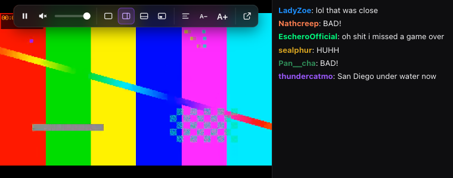
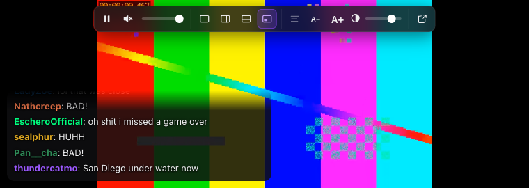

# Twitch PiP

A Chrome (Manifest V3) extension that pops the Twitch stream you are watching into an always-on-top Document
Picture-in-Picture window, with chat beside it, under it, or over it. The stream keeps playing through every transition,
and closing the window puts the video back in the tab. No Twitch API keys, no servers, no tracking.



## Install

```sh
bun install
bun run build
```

Open `chrome://extensions`, turn on Developer mode, choose Load unpacked, and pick the `dist/` folder. The first install
opens the options page. Chrome 116 or newer is needed for Document Picture-in-Picture.

## Usage

- Open a live channel at `https://www.twitch.tv/<channel>`. Click the PiP button in the player bar (its tooltip shows
  the hotkey) or press `Alt+Shift+P`. Press the hotkey again to close, in the tab or in the PiP window. The hotkey is ignored while you type in a text box.
- Layouts: video only, chat on the side, chat below, chat over the video (overlay). The toolbar at the top of the PiP
  window switches layout, controls playback and volume, and has a back-to-tab button. It shows on pointer movement or
  keyboard focus and hides after two seconds. In narrow windows the volume slider, layout buttons and chat text controls
  fold into popovers that open on hover or focus, and in the narrowest the toolbar keeps play, layout, back and a "more" menu.
- Chat sources: the official Twitch chat embed (you can type when you are logged in), or lite chat, a read-only chat
  list drawn by the extension (needed for overlay). Overlay always uses lite chat.
- Options (`chrome://extensions`, Details, Extension options; it also opens on first install): default layout and chat source, chat text size, overlay opacity, the
  shortcut, PiP quality, experimental automatic PiP, and a reset for sizes and settings. The window size is remembered per layout.

- Quality: by default ("Highest available") the PiP window keeps Twitch on Source quality with automatic quality off, and
  makes the tab look visible to Twitch while the window is open, so Twitch does not lower the quality or stop the stream
  when you switch tabs or apps. Both are undone when the window closes, and your saved Twitch quality is not touched.
  "Let Twitch decide" in the options page turns this off.



## Development

```sh
bun run check       # typecheck, unit tests, build
bun run typecheck
bun test src        # unit tests
bun run build       # writes dist/
bun run e2e         # one headless smoke test against a live twitch.tv channel
```

The smoke test needs network and the Playwright Chromium (`bunx playwright install chromium`). It skips if no channel is live and never opens a visible window. Design
notes are in `docs/design.md`, the feasibility findings in `docs/spike.md`.

## Known limits

- Real window chrome, the user-activation rule, window size on layout change, and automatic PiP can only be checked in a
  headed Chrome: see `docs/manual-test.md`.
- Chrome may refuse to resize the PiP window when you change layout. The layout still changes.
- Lite chat has no 7TV, BTTV or FFZ emotes, no badges, and cannot send messages. Use Twitch chat for that.
- The button shows on every channel page, live or not. An offline channel opens the VOD preview Twitch shows there. VOD and clip pages get no button.
- Twitch changes its page often. The selectors live in `src/services/TwitchPage.ts`; the live suite checks they still
  hold.
- Quality control uses Twitch's player internals (the React fiber of the player element). If Twitch changes them the
  extension logs one warning in the page console and leaves quality to Twitch; the live suite checks they still hold.
- Automatic PiP needs Chrome's per-site "Automatic picture-in-picture" permission for twitch.tv and is experimental.
- Chrome only: no Firefox or Safari.
