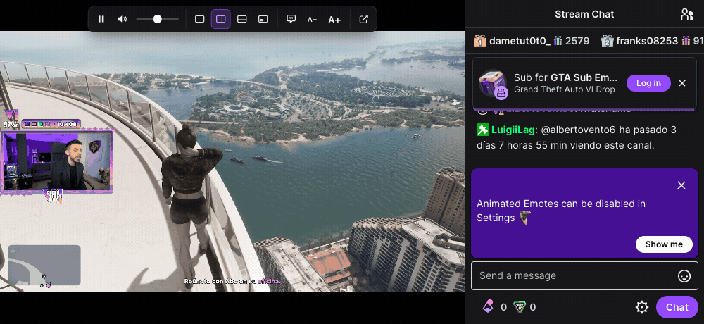
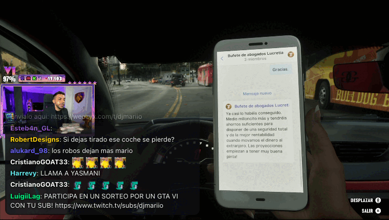

# Perch

Twitch streams in a floating picture-in-picture window, with chat.



## Features

- Four layouts: video only, chat beside, chat below, and lite chat over the video.
- Lite chat: a light, read-only chat list drawn by Perch, with Twitch and 7TV emotes, no login needed.
- Quality lock: keeps the stream at Source while you are in other tabs or apps.
- Automatic PiP when you switch tabs (experimental).
- One click or `Alt+Shift+P`. The stream never restarts, and closing the window puts the video back in the tab.

## Install

- Chrome Web Store: coming soon.
- From a release zip: download `perch-<version>.zip` from the releases page, unzip it, open `chrome://extensions`,
  turn on Developer mode, choose Load unpacked and pick the folder.
- From source: see Development below, then load `dist/` the same way.

Chrome 116 or newer is required for Document Picture-in-Picture.

## Usage

- Open a channel on twitch.tv and click the Perch button in the player bar, or press `Alt+Shift+P`. Press it again to
  close.
- The toolbar at the top of the window switches layout, controls playback and volume, and has a back-to-tab button.
- Chat source: the official Twitch chat (you can type when logged in) or lite chat. The overlay layout always uses lite
  chat.
- Options (`chrome://extensions`, Details, Extension options): default layout and chat source, text size, 7TV emotes, overlay
  opacity, shortcut, quality and automatic PiP.



Lite chat has no BTTV or FFZ emotes and cannot send messages. 7TV emotes can be turned off in the options. Automatic PiP needs Chrome's per-site permission
for twitch.tv.

## Privacy

Perch collects nothing and sends no data about you. Lite chat loads 7TV emote lists and images from 7tv.io, which you can turn off. See [PRIVACY.md](PRIVACY.md).

## Development

```sh
bun install
bun run build      # writes dist/
bun run check      # typecheck, unit tests, build
bun run e2e        # one headless smoke test against a live twitch.tv channel
bun run package    # builds and writes perch-<version>.zip for the Chrome Web Store
```

The smoke test needs network and Playwright's Chromium (`bunx playwright install chromium`). Design notes are in
[docs/design.md](docs/design.md).

## License

[MIT](LICENSE)
